<h1>Hi, I'm Abdoul Razack Ouedraogo 👋</h1>

**Full-stack developer** based in Ouagadougou, Burkina Faso 🇧🇫

I build web and mobile applications — especially **business software** that companies use every day:
ERP, invoicing, booking and real-estate management — from requirements to production.

- 🎓 Master's student in Information Systems Engineering (IBAM, Université Joseph Ki-Zerbo)
- 🌍 Open to full-time roles, freelance projects and remote work

## Tech stack

**Languages** 

<picture><source media="(prefers-color-scheme: dark)" srcset="assets/stack/php-dark.svg">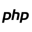</picture>
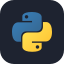

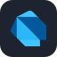

**Frontend** 

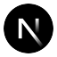
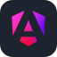
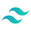

**Backend** 
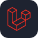

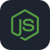

**Mobile & desktop** 

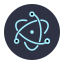

**Data & tools** 

<picture><source media="(prefers-color-scheme: dark)" srcset="assets/stack/mysql-dark.svg">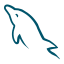</picture>

<picture><source media="(prefers-color-scheme: dark)" srcset="assets/stack/prisma-dark.svg">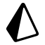</picture>
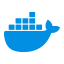

<picture><source media="(prefers-color-scheme: dark)" srcset="assets/stack/github-dark.svg">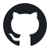</picture>

## Featured projects

| Project | What it is | Stack |
|---|---|---|
| [**ZackPDF**](https://github.com/codeByDarknet/zackpdf) | Free, open-source PDF reader with tabs and side-by-side panels — Windows, macOS, Linux | Electron, React, TypeScript |
| [**Learn Anything Skill**](https://github.com/codeByDarknet/learn-anything-skill) | Agent skill published on npm that turns any technology into a hands-on, auto-graded course | Node.js, CLI |
| [**Laafi**](https://github.com/codeByDarknet/laafi) | End-to-end encrypted messaging for public administration — team project, Hackathon 226 | TypeScript |
| [**MyCam**](https://github.com/codeByDarknet/cloneisocamera) | Native Android camera app with a built-in gallery and photo editor, zero dependencies | Kotlin, Camera2 |
| [**ZackTunes**](https://github.com/codeByDarknet/zacktunes) | Cross-platform desktop music player: local library and streaming | Electron, JavaScript |

Most of my client work (ERP, invoicing, hotel and real-estate management) is private — details on my portfolio.

## Let's connect

